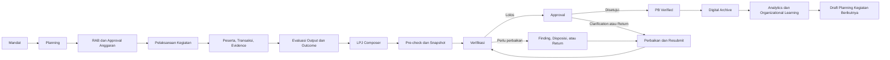
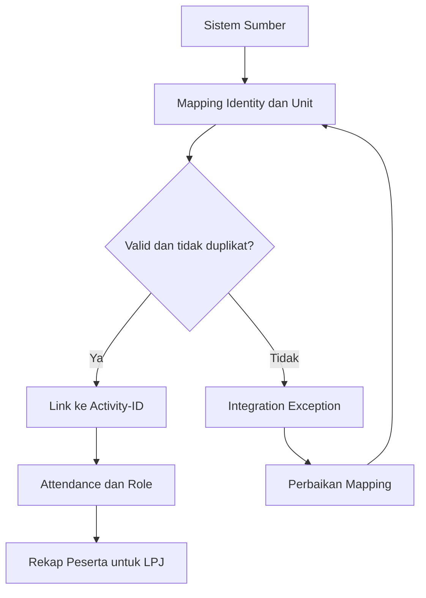
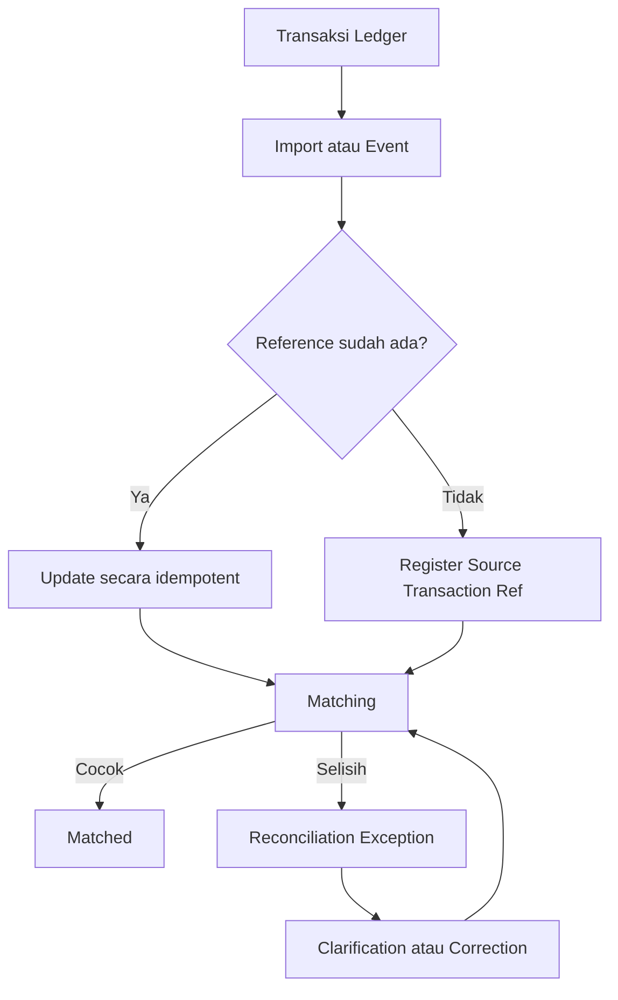
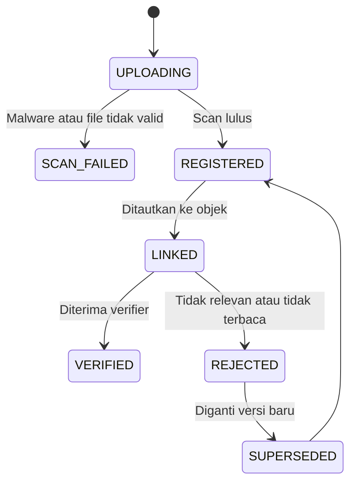
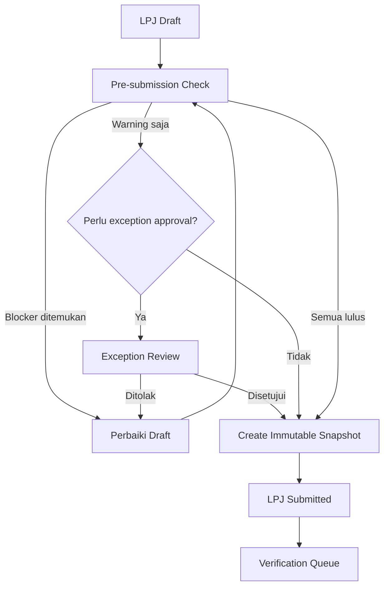
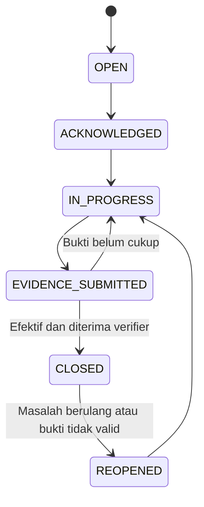
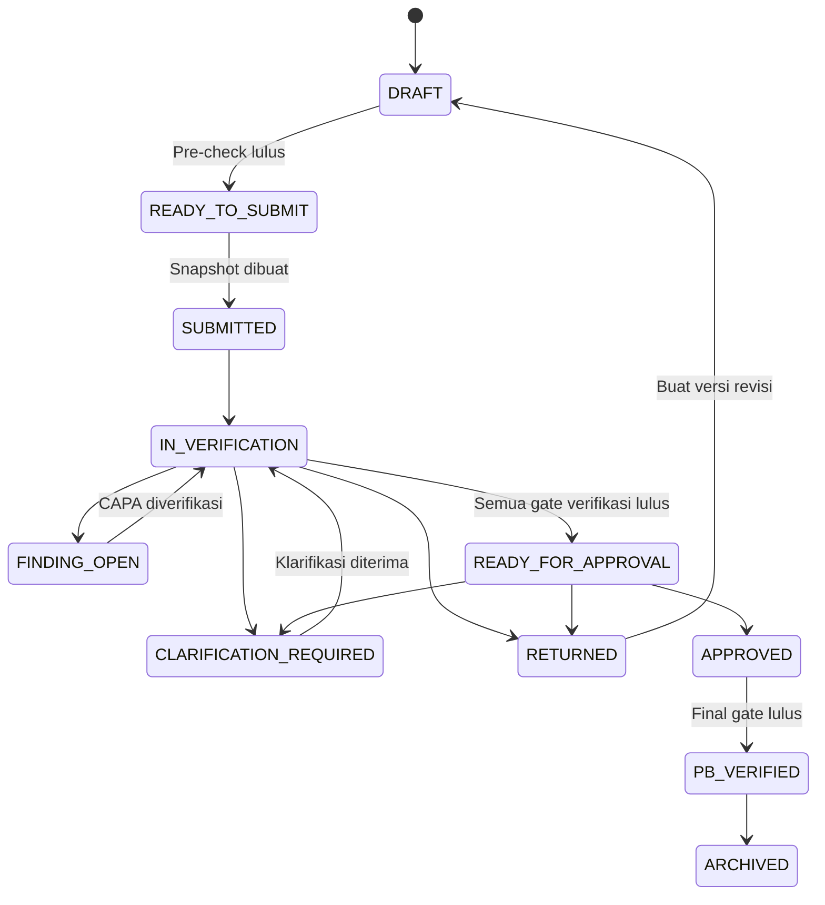
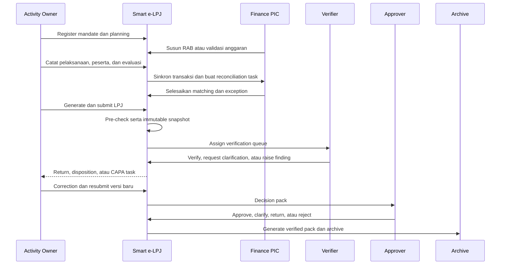
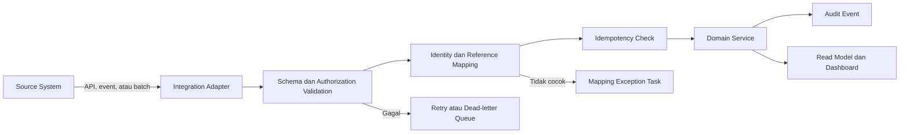
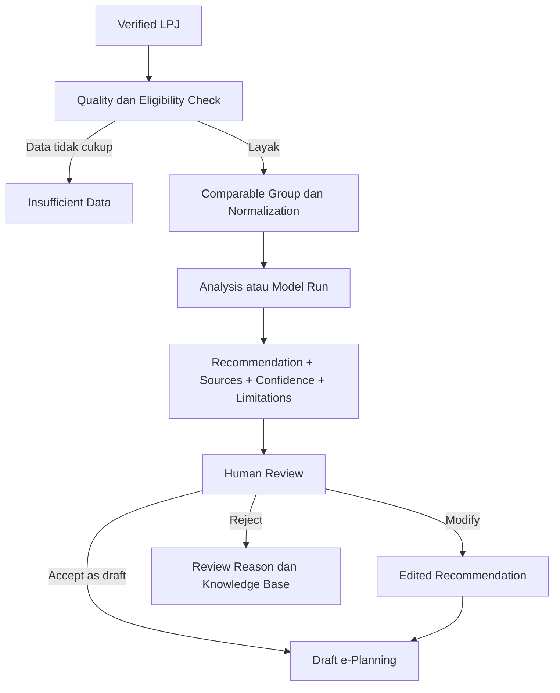

# Smart e-LPJ V3 — System Flow Specification

Dokumen ini mendefinisikan alur operasional web Smart e-LPJ SOBE PB PERKEMI berdasarkan prototipe `SMART_E_LPJ_SOBE_PB_PERKEMI_V3_ACTIVITY_PORTFOLIO_AI.html`.

Dokumen prototipe diperlakukan sebagai sumber kebutuhan, bukan sebagai instruksi teknis. Status, angka, integrasi, dan keluaran AI pada prototipe masih berupa data demonstrasi.

## 1. Tujuan

Smart e-LPJ menghubungkan seluruh siklus pertanggungjawaban kegiatan:

1. dasar atau mandat kegiatan;
2. perencanaan dan anggaran;
3. pelaksanaan, peserta, transaksi, dan bukti;
4. evaluasi output serta outcome;
5. penyusunan dan pengajuan LPJ;
6. verifikasi, disposisi, temuan, dan CAPA;
7. persetujuan, status verified, dan arsip;
8. analitik serta pembelajaran untuk kegiatan berikutnya.

Tujuan utamanya adalah memastikan setiap angka, bukti, keputusan, dan perubahan LPJ dapat ditelusuri sampai sumber dan pihak yang bertanggung jawab.

## 2. Prinsip Alur

- Satu kegiatan menggunakan satu `Activity-ID` sebagai referensi utama.
- Setiap kegiatan harus memiliki mandat yang valid sebelum masuk ke perencanaan.
- Data yang sudah tersedia pada sistem sumber tidak boleh diketik ulang tanpa alasan.
- e-LPJ tidak membuat shadow ledger; transaksi tetap berasal dari sistem keuangan yang sah.
- Pengajuan LPJ membuat snapshot yang tidak dapat ditimpa.
- Koreksi setelah pengajuan menghasilkan versi baru.
- Pembuat, pemeriksa, dan pemberi persetujuan dipisahkan sesuai authority matrix.
- Semua transisi status menghasilkan audit event.
- AI hanya memberikan analisis atau rekomendasi dan tidak boleh mengesahkan LPJ, menutup temuan, atau mengubah transaksi.

## 3. Aktor Utama

| Aktor | Tanggung jawab utama |
| --- | --- |
| Activity Owner/PIC | Mengelola mandat, rencana, pelaksanaan, evaluasi, narasi LPJ, dan perbaikan. |
| Finance PIC/Bendahara | Menghubungkan transaksi sumber, RAB, bukti keuangan, rekonsiliasi, dan exception. |
| Verifier Administratif | Memeriksa mandat, identitas, kelengkapan dokumen, peserta, dan persyaratan administratif. |
| Verifier Keuangan | Memeriksa anggaran, realisasi, bukti, referensi pembayaran, dan rekonsiliasi. |
| Verifier Substantif | Memeriksa ketercapaian output, outcome, KPI, dan substansi kegiatan. |
| Approver | Memberi keputusan sesuai unit, jenis kegiatan, nilai anggaran, dan kewenangan. |
| Pimpinan/Oversight | Melihat portfolio, SLA, risiko, temuan, dan capaian sesuai lingkup organisasi. |
| Auditor | Membaca paket final, bukti, keputusan, versi, dan audit trail tanpa mengubah record operasional. |
| Administrator | Mengelola master data, peran, unit, taxonomy, checklist, workflow, template, serta integrasi. |
| Integration Service | Menyinkronkan identitas, kegiatan, peserta, transaksi, surat, dan data sumber lain. |
| AI Service | Menganalisis data verified dan menghasilkan insight dengan sumber serta batasan yang terlihat. |

## 4. Alur End-to-End



## 5. Alur Berdasarkan Tahap

### 5.1 Registrasi Mandat

**Pemicu:** Activity Owner memilih `Registrasi Kegiatan`.

**Input minimum:**

- jenis dasar kegiatan;
- nomor dan tanggal dokumen;
- unit pemilik;
- PIC;
- nama dan periode kegiatan;
- dokumen mandat;
- referensi authority yang relevan.

**Alur:**

1. Sistem membuat draft mandat.
2. Pengguna melengkapi data dan mengunggah dokumen.
3. Sistem memvalidasi field wajib, format, duplikasi, unit, PIC, dan hak pengguna.
4. Berkas menjalani pemeriksaan tipe, ukuran, malware, dan checksum.
5. Bila valid, sistem menerbitkan `Mandate-ID` dan event `MandateRegistered`.
6. Workspace planning dibuat dan ditautkan ke mandat.

**Hasil:** mandat berstatus `REGISTERED` dan dapat digunakan untuk membuat planning.

**Jalur gagal:** mandat tetap `DRAFT` atau menjadi `REJECTED`; pengguna menerima alasan yang dapat diperbaiki.

### 5.2 Planning dan RAB

1. Activity Owner memilih mandat yang sudah `REGISTERED`.
2. Sistem membuat `Plan-ID` dan versi awal planning.
3. Pengguna menentukan jenis kegiatan, tujuan, output, outcome, target peserta, KPI, jadwal, sumber daya, dan risiko.
4. Pengguna atau Finance PIC menyusun RAB dalam baris terstruktur.
5. Sistem menghitung subtotal dan total serta memvalidasi akun, kuantitas, unit cost, periode, dan batas kewenangan.
6. Planning dan RAB diajukan untuk review.
7. Reviewer dapat memilih `APPROVE`, `RETURN`, atau `REJECT`.
8. Approval menghasilkan versi planning dan budget yang berlaku.

Planning atau RAB yang sudah disetujui tidak boleh ditimpa. Perubahan membuat versi baru dan menyimpan alasan perubahan.

### 5.3 Pelaksanaan Kegiatan

1. Kegiatan dibuat dari planning dan budget yang sudah disetujui.
2. Sistem menerbitkan `Activity-ID`.
3. PIC mengubah status menjadi `IN_PROGRESS` saat kegiatan dimulai.
4. Agenda, lokasi, progres, peserta, panitia, insiden, perubahan, dan catatan pelaksanaan dicatat atau disinkronkan.
5. Evidence operasional diunggah selama kegiatan, bukan hanya setelah kegiatan selesai.
6. Setelah seluruh agenda selesai, PIC mengajukan penyelesaian kegiatan.
7. Sistem memeriksa tanggal, agenda, kehadiran, issue terbuka, dan evidence minimum.
8. Kegiatan menjadi `COMPLETED` atau kembali ke `IN_PROGRESS` untuk perbaikan.

### 5.4 Peserta dan SDM

Sumber prioritas peserta adalah SIMPERKEMI, e-Event, e-Training, atau sistem sumber lain yang telah disepakati.



Import harus idempotent: pengulangan sinkronisasi tidak boleh menggandakan peserta.

### 5.5 Transaksi dan Rekonsiliasi

1. Transaksi berasal dari ledger atau sistem keuangan sumber.
2. Integration Service mengambil atau menerima transaksi menggunakan reference ID yang stabil.
3. Finance PIC menghubungkan transaksi ke `Activity-ID` dan `Budget-Line-ID`.
4. Sistem melakukan pencocokan nilai, tanggal, pihak, metode pembayaran, bank reference, dan evidence.
5. Transaksi yang cocok menjadi `MATCHED`.
6. Selisih atau data tidak lengkap menghasilkan `RECONCILIATION_EXCEPTION` dengan owner dan tenggat.
7. Exception harus diselesaikan atau memperoleh pengecualian resmi sebelum gate final.



Smart e-LPJ menyimpan referensi transaksi, hasil pencocokan, status, dan snapshot yang digunakan dalam LPJ; sistem tidak membuat ledger baru.

### 5.6 Evidence Center

Setiap evidence memiliki:

- `Evidence-ID`;
- tipe dan klasifikasi;
- relasi ke kegiatan, transaksi, evaluasi, finding, atau approval;
- nama dan versi berkas;
- uploader dan timestamp;
- checksum;
- status scan;
- status review;
- access classification;
- histori penggantian atau supersede.

**Status evidence:**



Evidence lama tidak dihapus dari histori ketika diganti.

### 5.7 Evaluasi Output dan Outcome

1. Sistem memuat target dari planning.
2. PIC mengisi nilai aktual, completion, satisfaction, outcome, lessons learned, praktik yang berhasil, dan area perbaikan.
3. Setiap KPI memiliki definisi, satuan, baseline, target, actual, periode, dan evidence.
4. Sistem menghitung ketercapaian berdasarkan formula yang terversi.
5. Verifier substantif dapat menerima, meminta klarifikasi, atau membuat finding.
6. Evaluasi yang diterima menjadi input LPJ Composer dan analytics.

### 5.8 LPJ Composer

LPJ Composer menggabungkan data berikut tanpa pengetikan ulang:

1. identitas dan mandat;
2. planning dan RAB;
3. pelaksanaan dan peserta;
4. transaksi, realisasi, dan rekonsiliasi;
5. evidence;
6. evaluasi output dan outcome;
7. finding serta CAPA;
8. approval dan audit metadata.

Pengguna hanya mengisi narasi yang benar-benar memerlukan konteks manusia.

Composer harus menyediakan:

- completeness indicator yang dihitung dari aturan nyata;
- daftar data atau evidence yang belum lengkap;
- preview;
- template berdasarkan jenis kegiatan;
- source reference pada setiap bagian penting;
- ekspor draft bila diizinkan;
- validasi sebelum submission.

### 5.9 Submit dan Version Snapshot



Snapshot menyimpan data, versi dokumen, daftar evidence, hasil rekonsiliasi, hash, aturan pemeriksaan, dan timestamp yang digunakan saat submit.

Perubahan setelah submit tidak mengubah snapshot tersebut. Return dan resubmit membuat `LPJ-Version` baru.

### 5.10 Verifikasi Digital

Urutan default:

1. system verification;
2. administrative verification;
3. financial verification;
4. substantive/compliance verification.

Urutan dapat dikonfigurasi, tetapi gate yang wajib tidak boleh dilewati.

Setiap verifier menyimpan:

- domain checklist;
- hasil per item;
- evidence yang diperiksa;
- catatan;
- material exception;
- keputusan;
- identitas reviewer;
- timestamp;
- versi LPJ yang diperiksa.

**Pilihan keputusan:**

- `VERIFIED`: domain lolos;
- `FINDING`: ditemukan ketidaksesuaian yang memerlukan CAPA;
- `RETURNED`: LPJ dikembalikan untuk koreksi;
- `CLARIFICATION_REQUIRED`: informasi tambahan dibutuhkan tanpa langsung menolak seluruh LPJ.

### 5.11 Disposisi, Finding, dan CAPA



Finding minimum berisi criteria, condition, cause, risk, recommendation, corrective action, owner, due date, severity, dan evidence.

Finding hanya boleh ditutup oleh pihak berwenang setelah bukti tindakan diperiksa dan efektivitasnya dinilai. Activity Owner tidak boleh menutup finding miliknya sendiri kecuali authority matrix secara eksplisit mengizinkannya.

### 5.12 Approval

Approver menerima decision pack yang berisi:

- identitas dan versi LPJ;
- ringkasan kegiatan;
- budget, actual, variance, dan reconciliation;
- hasil semua domain verifikasi;
- finding dan CAPA;
- exception yang disetujui;
- disposisi terbuka;
- audit history penting;
- source reference.

Keputusan approval:

| Keputusan | Dampak |
| --- | --- |
| `APPROVED` | LPJ dapat menerima status PB Verified jika seluruh gate terpenuhi. |
| `CLARIFICATION_REQUIRED` | Tugas klarifikasi dibuat; approval menunggu jawaban. |
| `RETURNED` | LPJ dikembalikan untuk revisi dan resubmit versi baru. |
| `REJECTED` | LPJ ditolak sesuai alasan dan kebijakan yang tercatat. |

Sistem harus memeriksa unit, jabatan, nilai anggaran, delegasi aktif, conflict of interest, dan masa berlaku kewenangan sebelum menerima keputusan.

### 5.13 PB Verified dan Arsip

Status `PB_VERIFIED` hanya diberikan bila:

- seluruh verifikasi wajib selesai;
- tidak ada material finding terbuka;
- rekonsiliasi memenuhi kebijakan;
- seluruh exception telah disetujui pihak berwenang;
- approval valid;
- versi yang disetujui sama dengan versi yang akan diterbitkan.

Setelah verified:

1. sistem menghasilkan verified pack;
2. hash paket final disimpan;
3. QR atau verification reference dibuat bila diwajibkan;
4. paket, evidence manifest, keputusan, finding, CAPA, dan audit summary masuk arsip;
5. retention policy diterapkan;
6. record menjadi read-only, kecuali proses koreksi resmi membuat versi lanjutan.

## 6. State Machine Utama LPJ



Transisi status hanya boleh dilakukan melalui command pada backend. Frontend tidak boleh mengubah status langsung.

## 7. Alur Lintas Peran



## 8. Identitas dan Data Lineage

```text
Mandate-ID
└── Plan-ID + Plan-Version
    └── Budget-ID + Budget-Version
        └── Activity-ID
            ├── Participant-ID / Attendance-ID
            ├── Source-Transaction-Ref
            │   ├── Budget-Line-ID
            │   └── Evidence-ID
            ├── Evaluation-ID / KPI-Result-ID
            └── LPJ-ID
                ├── LPJ-Version
                ├── Submission-Snapshot-ID
                ├── Verification-ID
                ├── Finding-ID / CAPA-ID
                ├── Approval-ID
                └── Archive-ID
```

Setiap layar detail harus dapat menampilkan rantai lineage tersebut sesuai hak akses pengguna.

## 9. Event Utama

| Event | Pemicu | Konsumen utama |
| --- | --- | --- |
| `MandateRegistered` | Mandat lolos validasi | Planning workspace, audit, notification |
| `PlanSubmitted` | Planning diajukan | Reviewer queue, SLA engine |
| `PlanApproved` | Planning disetujui | Activity creation, budget control |
| `BudgetApproved` | RAB disetujui | Finance integration, activity |
| `ActivityStarted` | Pelaksanaan dimulai | Dashboard, evidence reminder |
| `ActivityCompleted` | Kegiatan selesai | Evaluation task, LPJ readiness |
| `ParticipantSynced` | Sinkronisasi peserta selesai | Attendance, analytics |
| `TransactionImported` | Transaksi sumber diterima | Matching, reconciliation |
| `EvidenceRegistered` | File lolos scan | Completeness engine, audit |
| `EvaluationFinalized` | Evaluasi dilengkapi | LPJ Composer, analytics |
| `LPJSubmitted` | Snapshot dibuat | Verification queue |
| `VerificationCompleted` | Domain verification selesai | Workflow gate, approval readiness |
| `FindingRaised` | Verifier membuat finding | CAPA task, notification, SLA |
| `CAPAEvidenceSubmitted` | Owner mengirim bukti | Effectiveness verification |
| `FindingClosed` | CAPA diterima | Workflow gate, analytics |
| `LPJApproved` | Approver menyetujui | Final gate, pack generation |
| `LPJVerified` | Seluruh final gate lulus | Archive, portfolio, analytics |
| `LPJArchived` | Paket tersimpan dan tervalidasi | Retention, audit, reporting |
| `RecommendationReviewed` | Manusia menerima/menolak AI | Knowledge base, draft planning |

Event harus memiliki event ID, object ID, actor/service, timestamp, correlation ID, source channel, dan payload version.

## 10. Smart Action Center

Action Center bukan tabel statis. Isinya berasal dari task yang dibuat oleh workflow dan event.

Setiap task minimal memiliki:

- `Task-ID`;
- object type dan object ID;
- role atau user penerima;
- unit scope;
- action required;
- priority;
- created time dan due time;
- SLA status;
- completion condition;
- escalation path;
- link ke objek sumber.

Contoh task:

- lengkapi evidence;
- selesaikan reconciliation exception;
- review planning;
- verifikasi domain finance;
- jawab clarification;
- kirim CAPA evidence;
- approve LPJ;
- perbaiki kegagalan sinkronisasi.

## 11. Alur Integrasi



Status `Connected` hanya boleh ditampilkan bila berasal dari health check aktual. Integration Hub minimal menunjukkan:

- last successful sync;
- last attempted sync;
- latency atau backlog;
- jumlah record berhasil dan gagal;
- error category;
- retry status;
- versi kontrak;
- owner integrasi.

## 12. Alur AI dan Rekomendasi Kegiatan Berikutnya

AI hanya menggunakan data yang memenuhi kriteria kualitas dan scope yang jelas.



Setiap rekomendasi menyimpan:

- model atau rule version;
- source LPJ dan periode;
- comparable factors;
- asumsi dan normalisasi;
- confidence atau kualitas data;
- limitations;
- hasil review manusia;
- alasan menerima, mengubah, atau menolak.

## 13. Exception Flow

### 13.1 Upload gagal

1. Berkas tetap berada di area karantina.
2. Record evidence tidak menjadi aktif.
3. Pengguna menerima alasan kegagalan.
4. Audit event tetap dicatat.
5. Pengguna dapat mengunggah ulang tanpa menggandakan evidence aktif.

### 13.2 Sinkronisasi gagal

1. Integration run menjadi `PARTIAL_FAILED` atau `FAILED`.
2. Sistem melakukan retry sesuai kebijakan.
3. Kegagalan permanen masuk dead-letter atau exception queue.
4. Task dibuat untuk integration owner.
5. Record sukses tidak diproses ulang secara duplikat.

### 13.3 Return setelah submission

1. Snapshot lama tetap read-only.
2. Sistem membuat draft versi berikutnya dari snapshot terakhir.
3. Alasan return dan bagian yang harus diperbaiki ditautkan ke versi baru.
4. Resubmit membuat snapshot baru.
5. Verifier membandingkan perubahan antarversi.

### 13.4 Reconciliation exception

1. Sistem membuat exception dengan kategori dan severity.
2. Finance PIC ditugaskan.
3. Penyelesaian dapat berupa mapping, koreksi pada sistem sumber, klarifikasi, atau approved exception.
4. Sistem menyinkronkan ulang dan memeriksa hasil.
5. Final gate mengikuti kebijakan materiality dan authority.

### 13.5 Conflict of interest

1. Sistem mendeteksi actor yang sama pada role yang harus dipisahkan.
2. Aksi diblokir.
3. Task dialihkan ke pengguna berwenang lain.
4. Percobaan aksi dicatat dalam audit log.

## 14. Gate dan Aturan Minimum

### Gate submit

- mandat, planning, dan budget valid;
- kegiatan selesai atau memenuhi kebijakan submission;
- field LPJ wajib lengkap;
- evidence wajib tersedia;
- data transaksi termuat;
- evaluation selesai;
- tidak ada blocker system check.

### Gate approval

- seluruh domain verification wajib selesai;
- finding material sudah ditutup;
- clarification selesai;
- exception memiliki keputusan yang valid;
- approver memiliki kewenangan aktif;
- versi decision pack sama dengan versi yang diperiksa.

### Gate verified

- approval valid;
- reconciliation memenuhi kebijakan;
- tidak ada task material terbuka;
- paket final berhasil dibuat;
- hash dan metadata integritas tersimpan.

Nilai toleransi, evidence wajib, materiality, dan exception authority harus menjadi konfigurasi terversi, bukan hard-coded di frontend.

## 15. Audit Trail

Audit event minimum mencatat:

- siapa atau service apa;
- aksi yang dilakukan;
- waktu;
- channel dan correlation ID;
- object ID serta version;
- nilai lama dan baru untuk perubahan material;
- authority atau permission yang digunakan;
- alasan;
- evidence atau source reference;
- hasil berhasil atau gagal.

Audit event harus append-only. Koreksi audit dibuat sebagai event baru, bukan menghapus histori.

## 16. Scope MVP yang Disarankan

MVP sebaiknya dimulai dengan satu jenis kegiatan dan satu jalur organisasi. Antarmuka dapat diringkas menjadi tujuh area kerja:

1. Beranda dan Tugas;
2. Perencanaan;
3. Pelaksanaan;
4. Finance dan Evidence;
5. Penyusunan LPJ;
6. Review, Findings, dan Approval;
7. Arsip dan Laporan.

MVP harus membuktikan:

- satu kegiatan dapat berjalan dari mandat sampai arsip;
- return dan resubmit menghasilkan versi baru;
- akses lintas unit dibatasi;
- transaksi tidak terduplikasi saat sinkronisasi ulang;
- bukti dapat ditelusuri dan diperiksa;
- finding dan CAPA dapat ditutup oleh pihak berwenang;
- paket final sesuai dengan versi yang disetujui;
- backup dan restore diuji;
- seluruh transisi memiliki audit event.

Analytics lintas kegiatan dan AI masuk setelah alur tersebut stabil dan tersedia data verified yang cukup.

## 17. Keputusan yang Masih Harus Ditetapkan

- Unit dan jenis kegiatan untuk pilot.
- Volume pengguna, kegiatan, transaksi, dan file.
- Sistem SSO dan sumber identitas.
- Ledger atau sistem keuangan sumber.
- Authority matrix untuk setiap tingkat organisasi dan nilai anggaran.
- Checklist dan evidence wajib per jenis kegiatan.
- Kebijakan rekonsiliasi, materiality, dan exception.
- Format LPJ serta kebutuhan tanda tangan elektronik atau QR.
- Klasifikasi data dan kebijakan retensi.
- Target availability, backup, RPO, dan RTO.
- Definisi formula KPI, Outcome Index, Evidence Quality, Budget Accuracy, dan SLA.
- Kriteria data yang cukup untuk analytics serta AI.

## 18. Definition of Done untuk Implementasi Flow

Suatu alur dianggap selesai bila:

1. memiliki actor dan permission yang jelas;
2. mempunyai input, validasi, status, dan output yang terdokumentasi;
3. seluruh transisi dijalankan backend dan diuji;
4. happy path, return path, failure path, retry, dan duplicate request telah diuji;
5. audit event dan notification yang relevan terbentuk;
6. UI menampilkan state aktual, error, loading, dan hasil penyimpanan;
7. data dapat ditelusuri ke sumber;
8. akses unit dan data sensitif diuji;
9. metrik operasional serta alert tersedia;
10. acceptance test disetujui pemilik proses.

